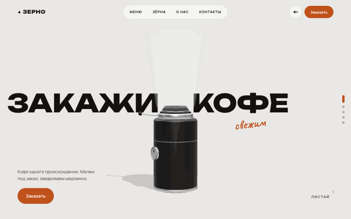

# ЗЕРНО — сайт кофейни с 3D по скроллу

**Демо:** https://isaturnalia.github.io/zerno-coffee/ · [3D-модели](https://isaturnalia.github.io/zerno-coffee/models.html) · [макет](https://isaturnalia.github.io/zerno-coffee/mockup.html)



Демо-проект для портфолио: одностраничный сайт кофейни, где прокрутка «проигрывает» путь чашки кофе. Зёрна сыплются в кофемолку, кофемолка разбирается до жерновов, чайник льёт воду в пуровер, капля падает в кофе, и в конце над чашкой поднимается пар, а снизу выезжает меню.

Все 3D-модели построены в коде, без готовых файлов: кофемолка, зёрна, чайник с носиком, воронка V60 с графином, чашка с ложкой, капля и круги на кофе.

## Сцены

| # | Сцена | Что происходит |
|---|---|---|
| 0 | **Закажи кофе** | Заголовок стоит за стеклянным бункером, в бункер сыплются зёрна |
| 1 | **Точный помол** | Корпус расходится, видны жернова, сыплется помол |
| 2 | **Медленная заливка** | Чайник наклоняется и льёт воду. Счётчики 92°C · 18 г · 3:30 идут вместе со скроллом |
| 3 | **Каждая капля** | Экран темнеет, капля падает в кофе, расходятся круги и подпрыгивает капля отдачи |
| 4 | **Выбери свой ритуал** | Пар над чашкой, карточки меню. Картинки на карточках рендерятся из тех же 3D-моделей |
| 5 | **Заварим дома** | Калькулятор рецепта V60: чашки и крепость → граммы, вода, время, шаги |
| 6 | **Заходи на чашку** | Контакты и схема проезда |

## Интерактив

- **3D-карточка товара.** Тап по карточке меню открывает модель, которую можно крутить.
- **Латте-арт.** В карточке капучино можно рисовать пальцем или мышкой по пенке, рисунок медленно расплывается.
- **Корзина.** «+» отправляет зерно в корзину, в выезжающей панели меняется количество и считается сумма.
- **Звук по желанию.** Синтезируется в Web Audio без аудиофайлов: зёрна стучат о стекло, хрустят жернова, шумит заливка, капля делает «плюх».
- **Переход «кофе заливает экран»** перед сценой с каплей.
- **Зерно плёнки** поверх всего сайта.
- **Свет по времени суток.** Вечером солнце ниже и теплее, тени длиннее. Посмотреть режимы можно параметром `?time=evening`, `?time=morning` или `?time=day`.

## Детали

- **Камера и тексты по скроллу.** Один мастер-таймлайн GSAP (5 единиц = 5 сцен) управляет и текстами, и 3D-сценой.
- **Плавный скролл** с инерцией на Lenis.
- **Курсор** с кольцом и магнитные кнопки. Сцена слегка смещается за мышью. Наведение на кофемолку раскручивает жернова, пар отклоняется к курсору.
- **Пар** — собственный GLSL-шейдер на шумах fbm.
- **Адаптивность.** На вертикальных экранах камера отъезжает и композиция перестраивается, карточки меню листаются свайпом.
- **Уменьшение движения.** Учитывается `prefers-reduced-motion`.

## Стек

HTML, CSS и JavaScript без сборки.

- [three.js](https://threejs.org/) 0.160 — 3D
- [GSAP](https://gsap.com/) 3.12 + ScrollTrigger — анимации по скроллу
- [Lenis](https://github.com/darkroomengineering/lenis) 1.1 — плавный скролл
- Шрифты Unbounded, Caveat и Manrope (Google Fonts)

## Запуск

ES-модулям нужен локальный сервер: через `file://` страница не откроется.

```bash
python3 -m http.server 5173
```

Затем открыть http://localhost:5173.

## Структура

```
index.html        сайт
css/site.css      стили
js/site.js        сцены, камера, анимации, курсор
js/models.js      процедурные 3D-модели, материалы и шейдер пара
js/shop.js        корзина, 3D-карточка товара, латте-арт
js/brew.js        калькулятор заваривания
js/sound.js       звук на Web Audio
icons/, og.png    иконка сайта и обложка для превью ссылки
docs/demo.gif     запись прокрутки для README
models.html       просмотрщик моделей (js/viewer.js)
mockup.html       макет сцен — этап проектирования
scenario.md       сценарий сайта — этап проектирования
```

## Процесс

1. Разбор референса: запись экрана с сайта-концепта, где скролл проигрывает видео.
2. [Сценарий](scenario.md) — что происходит в каждой сцене на каждом проценте скролла.
3. [Макет](mockup.html) — ключевые кадры сцен и таймлайн анимаций.
4. [3D-модели](models.html) — процедурно, на профилях вращения и физических материалах.
5. Сборка сайта, адаптация под мобильные, интерактив.

---

Кофейня «ЗЕРНО» вымышленная. Адрес и телефон на сайте — заглушки.
